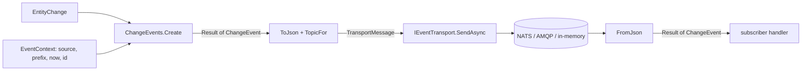
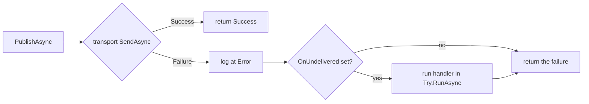

# Eventually core: plan

## Stack

- .NET 11 and C# 15, same global constraints as stand-sure-functional (warnings as errors, no throwing APIs, failure-first Match, braces, one type per file, xUnit v3 with AwesomeAssertions, feature branches, draft PRs).
- StandSure.Functional from the stand-sure-org GitHub Packages feed (main has published 0.1.0-rc-2).
- Core depends only on StandSure.Functional, Microsoft.Extensions.DependencyInjection.Abstractions and Microsoft.Extensions.Logging.Abstractions (for the undelivered-event log). JSON through System.Text.Json. Time comes from the BCL TimeProvider, ids from Guid.CreateVersion7.
- NATS adapter on NATS.Net (3.4.1, published Nov 19 on nuget.org). AMQP adapter on RabbitMQ.Client (7.3.0) in a later phase.
- The wire is always CloudEvents structured JSON. In code, an event is our own immutable C# record rather than the CloudNative.CloudEvents SDK's CloudEvent class: the record gives value equality and Option-typed fields for pure functions and property tests, and validation returns a Result, where the SDK's CloudEvent is a mutable attribute bag whose setters validate on assignment and whose Validate throws InvalidOperationException. The cost is writing our own small JSON formatter for about ten attributes. An optional StandSure.Eventually.CloudEvents package can map to and from the SDK's CloudEvent for anyone using its Kafka, MQTT or HTTP bindings. The SDK's NATS binding is a third-party 1.0.0-preview from April 2023 on the old NATS.Client, past the repo's two-year staleness rule.

## Shape: pure core, effects at the edges



The shell reads the clock and makes the id once, puts them in EventContext, and everything after that is deterministic until the transport call. Only the transport and the handler call are effects, and both are wrapped in Try.RunAsync at the edge.

## Core types (sketch)

```csharp
public enum ChangeVerb { None, Create, Update, Patch, Archive, Delete, Purge }

public readonly record struct Tenant   // Tenant.Of("t1") or Tenant.None: never left out by accident
{
    public static Tenant None { get; }
    public static Tenant Of(string id);
    public Option<string> Id { get; }
}

public sealed record EntityChange(string EntityType, string EntityId, ChangeVerb Verb,
    Tenant Tenant, Option<JsonElement> Data);

public sealed record EventContext(Uri Source, DateTimeOffset Now, Guid Id);

// One CloudEvent: required and optional attributes, plus our extension attributes.
public sealed record ChangeEvent(string Id, Uri Source, string Subject, DateTimeOffset Time,
    string EntityType, string EntityId, ChangeVerb Action, Option<string> TenantId, Option<JsonElement> Data)
{
    public const string Type = "standsure.eventually";   // fixed; also the topic root
}

public static class ChangeEvents
{
    public static Result<ChangeEvent> Create(EntityChange change, EventContext context);   // pure; subject = {entitytype}:{action}:{entityid}
    public static string TopicFor(ChangeEvent e);                                         // pure
    public static ReadOnlyMemory<byte> ToJson(ChangeEvent e);                              // pure
    public static Result<ChangeEvent> FromJson(ReadOnlySpan<byte> json);                   // pure
}

public interface IEventTransport
{
    Task<Result<Unit>> SendAsync(TransportMessage message, CancellationToken ct);
    Result<IAsyncDisposable> Subscribe(string filter, Func<TransportMessage, CancellationToken, Task> onMessage);
}

public interface IChangePublisher
{
    Task<Result<Unit>> PublishAsync(EntityChange change, CancellationToken ct);
}
```

The publisher is one pipeline over the library's combinators:

```csharp
public Task<Result<Unit>> PublishAsync(EntityChange change, CancellationToken ct) =>
    Task.FromResult(ChangeEvents.Create(change, contexts.Next()))
        .MapAsync(TransportMessage.For)   // ToJson + TopicFor
        .BindAsync(message => transport.SendAsync(message, ct));
```

Create validates every field and returns one Validation error with all children (via Combine), so a caller sees every problem at once. Transport adapters map client exceptions to Unavailable with MapError and Wrap.

## Wire format

Structured content mode, JSON only: each message's payload is the whole CloudEvent as JSON, with content type application/cloudevents+json (a NATS header on NATS, the AMQP content-type property on AMQP). Audit data, when present, is the event's data member with datacontenttype application/json. One format on every transport keeps parsing to one pure function and lets any CloudEvents-aware tool read the messages.

## No-ack semantics

Delivery is at most once. For NATS core, success means the client accepted the message into its connection; there is no server confirmation. Subscribers never ack. Handler failures are counted, not retried. A consumer that must not miss events needs to reconcile by fetching, or a durable path (open question 9).

## When the backend is down

Publish never hides a failure: it returns Unavailable (or Unexpected) to the caller either way. On top of that, the publisher runs the configured undelivered handling, so a caller that ignores the Result still leaves a trace.

```csharp
public sealed record UndeliveredEvent(ChangeEvent Event, string Topic, Error Error);

// Options
public Func<UndeliveredEvent, CancellationToken, Task>? OnUndelivered { get; set; }
```

The default is one structured log entry at Error. When OnUndelivered is set, it runs after that entry, inside Try.RunAsync, so its own failure is logged at Error rather than thrown. Typical handlers write to a local file, a dead-letter table, or a metric. The library itself keeps no buffer and never retries.



## A failed publish: the caller decides

The library never decides what a failed publish means for the update. It returns the failure, logs it, runs the caller's handler if there is one, and stops. The docs show the common choices:

- **Log and carry on:** a decorator over the repository commits the update, publishes, and only logs a failure. Simple, but consumers can miss changes.
- **The message is part of the update:** publish inside the unit of work and roll back when publishing fails, so a failed message means a failed update. This is Chris's own view, offered as a pattern, not a default.
- **Outbox:** write the event in the same transaction as the update and publish it afterwards. The strongest guarantee, and it couples to persistence, so it stays outside this library.

Two things make the second pattern honest. First, NATS core gives no server receipt, so "published" there only means the client took it; a caller who rolls back on failure should set a confirmation level that waits for the server (a round trip after publish, or a JetStream publish acknowledgement, which is the server confirming receipt, not a consumer ack). Second, because consumers fetch fresh data, publishing before commit is mostly safe: if the commit then fails, consumers fetch and find nothing changed. A create or delete that never committed is the exception, since the fetch finds no entity.

```csharp
// The message is part of the update: one Result pipeline, rollback on any failure.
Result<Unit> saved = await repository.SaveAsync(invoice, ct)          // Task<Result<Invoice>>
    .BindAsync(i => publisher.PublishAsync(Changes.Update(i), ct));
if (saved.IsFailure)
{
    await unitOfWork.RollbackAsync(ct);
}
```

stand-sure-functional has TapError on Result but no TapAsync or TapErrorAsync on Task of Result yet, so the rollback is a plain if. Exercising the library is meant to surface gaps like this one; it's a candidate addition there.

## Topics

A pure TopicFor maps an event to a dot-separated NATS or AMQP subject in the same order as the CloudEvents subject: entity type, verb, entity id, then tenant. The CloudEvents subject itself can't serve, because NATS wildcards only match whole dot-separated tokens, so a pattern like Invoice:delete:\* isn't possible. The topic starts with the fixed standsure.eventually, and each of the four parts after it is exactly one token, percent-encoded where needed, so every wildcard pattern has a fixed shape.

```text
standsure.eventually.{entitytype}.{action}.{entityid}.{tenant}
standsure.eventually.invoice.update.42.t1
standsure.eventually.StandSure%2EBilling%2EInvoice.update.42.t1    entity type StandSure.Billing.Invoice
standsure.eventually.user.update.chris@example.com._                hypothetical id chris@example.com, no tenant
```

Without encoding, a dotted entity type or id adds tokens, so the verb and tenant shift position and fixed-shape patterns such as the every-delete one below miss the event; with dots in two parts, different events can even produce the same topic. Per the NATS docs, a subject token may hold any Unicode character except null, space, . \* and >; the recommended set is letters, digits, - and \_, with at most about 16 tokens and 256 characters. % is allowed but outside the recommended set.

NATS wildcards (`*` for one token, `>` for the rest) and AMQP topic-exchange patterns (`*` and `#`) both filter on it. A matching pure filter builder turns selections into patterns, for example `standsure.eventually.invoice.>` for every invoice change, `standsure.eventually.*.delete.>` for every delete of any entity type, `standsure.eventually.invoice.*.42.*` for every change to invoice 42, and `standsure.eventually.*.*.*.t1` for everything in tenant t1.

## DI

```csharp
services.AddEventually(o =>
        {
            o.Source = new Uri("urn:example:billing");
            o.OnUndelivered = (undelivered, ct) => deadLetters.WriteAsync(undelivered, ct); // optional
        })
        .UseNats(o => o.Url = "nats://localhost:4222");
```

Options are validated at startup. UseInMemory() serves tests and samples.

## Projects

- src/StandSure.Eventually: types, pure functions, ports, publisher, subscriber, DI.
- src/StandSure.Eventually.Testing: in-memory transport and the abstract contract suite.
- src/StandSure.Eventually.Nats: NATS core adapter.
- src/StandSure.Eventually.Amqp: later phase.
- tests/ per project, benchmarks/, docs/llm-api-summary.md for agents, CLAUDE.md with the consumer block.

## Risks

- **Audit vs no-ack:** an audit log fed by at-most-once events can have gaps. Decide whether audit gets a durable path.
- **Mutation and publish aren't atomic:** a crash between commit and publish loses the event. The outbox pattern fixes that but couples the library to persistence (open question 5).
- **CI needs a NATS server:** the Oui-DELIVER .NET workflow may need a service-container option for integration tests.
- **Feed auth:** consuming StandSure.Functional from GitHub Packages needs a read token in CI and locally.

